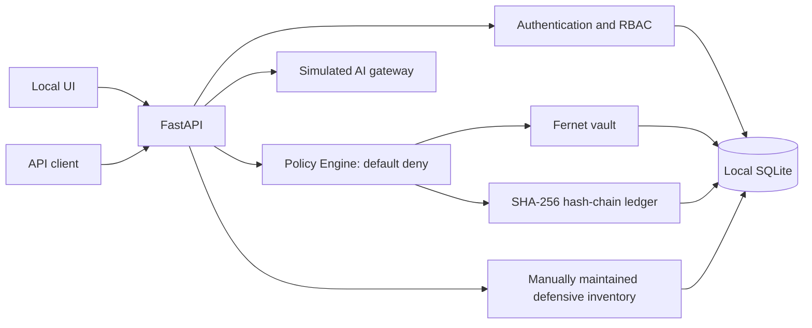

# Sentinela Brasil

**An open demonstrator for data sovereignty, defensive cybersecurity, and trustworthy AI governance.**

- Organization provided by the project owner: Impulso Digital Soluções em I.A.
- Founder/project lead provided: Felipe Marcos de Abreu Aquino
- Intended repository: `sentinela-brasil`
- Software version: `0.1.0` (demonstration core; not a production release)
- Languages: Brazilian Portuguese and English
- License: Apache-2.0

> **Disclaimer:** this is an independent initiative. It is not approved, certified, accredited, endorsed, or adopted by any government, military, or critical-infrastructure authority. Use synthetic data only. This is not production-ready software and must not be relied upon to protect critical systems.

## Mission and scope

Demonstrate locally how explicit access controls, encrypted file storage, verifiable audit events, explainable policy decisions, and a no-egress AI gateway can work together. This initial version deliberately performs no network scanning, exploitation, command execution, external model/API calls, or covert collection.

## Implemented features

- **Local vault:** JSON/Base64 upload up to 2 MiB, basic validation, Fernet encryption using `cryptography`, data classification, RBAC, and authorized export.
- **Identity and access:** explicit administrator bootstrap, standard-library scrypt password hashing, one-hour HMAC bearer tokens, administrator-managed users, and default-deny file access policies.
- **Policy Engine:** versioned declarative rules over role, classification, and action, with explainable `reason_code` and policy version.
- **Audit ledger:** SHA-256 hash chain, minimized events, and integrity verification endpoint. This detects some changes; it is not absolute immutability.
- **Demonstration AI gateway:** heuristic detection of email, CPF-like identifiers, and credential-like strings; strict mode blocks detected patterns and `redact` masks them. No external model/provider is called.
- **Defensive asset profile:** synthetic inventory CRUD without connecting to networks or devices.
- **Local web dashboard:** login, counts, recent events, ledger status, and inventory; safe DOM `textContent`, session token in `sessionStorage`, basic security headers.
- **Local checks:** pytest, Ruff lint, dependency audit, and a CycloneDX SBOM.

## Architecture



See [architecture/data flow](docs/architecture/ARCHITECTURE.md) and the [threat model](docs/threat-model/THREAT_MODEL.md).

## Requirements and local installation

Python 3.11+. Docker Compose is optional. The first version targets one local process and one SQLite database; do not run multiple workers.

```bash
git clone https://github.com/felipetjmg1-bit/sentinela-brasil.git
cd sentinela-brasil
python3 -m venv .venv
. .venv/bin/activate
python -m pip install --upgrade pip
pip install -e '.[test,dev]'
cp .env.example .env
```

Replace every placeholder in `.env`. Generate fresh values; never reuse these examples:

```bash
python -c 'import secrets; print(secrets.token_urlsafe(48))'  # SENTINELA_TOKEN_SECRET
python -c 'from cryptography.fernet import Fernet; print(Fernet.generate_key().decode())'  # SENTINELA_VAULT_KEY
python -c 'import secrets; print(secrets.token_urlsafe(24))'  # unique admin password, min. 16 chars
```

In Bash, load the variables and bind to loopback:

```bash
set -a; . ./.env; set +a
uvicorn sentinela.main:app --app-dir src --host 127.0.0.1 --port 8000 --workers 1
```

On the first startup, an administrator is created only when the database has no users and both `SENTINELA_BOOTSTRAP_ADMIN_USERNAME` and `SENTINELA_BOOTSTRAP_ADMIN_PASSWORD` are set. Remove those two variables after bootstrap. Open `http://127.0.0.1:8000/`. Local API documentation is at `/docs`.

For Windows, install Python 3.11+, create a virtual environment with `py -m venv .venv`, activate it in PowerShell, install the same extras, and set environment variables before starting Uvicorn. Do not expose the listening port to a network.

### Mobile

The UI is responsive and can be viewed on a phone when the service runs on a computer. LAN access requires a firewall and TLS reverse proxy and is not hardened by v0.1.0. Android Termux is experimental and unsupported; iOS is not a supported runtime. The recommended setup is a computer bound to `127.0.0.1`.

## Docker Compose

Set strong fresh secrets in `.env` before starting. The service binds to host loopback and stores data in the local `sentinela_data` volume.

```bash
docker compose up --build
```

See [deployment procedures](docs/deployment/DEPLOYMENT.md) for backup, restore, and deletion. A database backup without the external encryption keys cannot recover encrypted contents.

## Reproducible example and tests

Login with `POST /api/auth/login`, then use the returned token as `Authorization: Bearer <token>` for `/api/dashboard`, `/api/policies`, and `/api/assets`. `POST /api/ai/evaluate` accepts `{"prompt":"synthetic demo text","mode":"strict"}`. This is not real inference.

Run:

```bash
pytest
ruff format --check .
ruff check .
pip-audit --skip-editable
```

Tests cover authentication, negative RBAC, object isolation, encryption/export, invalid uploads, gateway blocking/redaction, ledger tamper detection, assets, dashboard, and headers. Executed results are in [docs/VALIDATION.md](docs/VALIDATION.md). GitHub Actions is not yet active in the remote repository; its prepared workflow file remains outside the public commit until workflow permission is available. The checked-in CycloneDX SBOM inventories the tested environment; it is not proof that dependencies are vulnerability-free.

## Security, privacy, and limitations

Read [SECURITY.md](SECURITY.md), [threat model](docs/threat-model/THREAT_MODEL.md), and [privacy notes](docs/privacy/PRIVACY.md). Demonstration controls do not replace an independent security review, authorized penetration testing, TLS, managed key custody, tested backups, incident response, or organizational controls.

Known limitations include local SQLite, one process, no HA or multi-tenancy; one-hour bearer tokens without individual revocation; no robust distributed rate limiting; operator-managed HMAC/Fernet keys; no KMS/HSM, automated key rotation, mTLS, SSO, WORM ledger, or external anchor; incomplete PII detection and regex redaction; no remote asset configuration checks; simulated AI gateway. Someone controlling the database and host can rewrite the complete ledger. See the roadmap for evaluation steps.

## Strategic positioning and roadmap

Sentinela Brasil is an independent Brazilian R&D initiative concerning data sovereignty, defensive cybersecurity, and AI governance. Potential applications in public organizations, research, and critical infrastructure require further evaluation, legal review, operational controls, and independent validation. No institutional adoption is claimed.

Suggested roadmap: (1) independent security and accessibility review; (2) tested migrations, session revocation, rate limiting, and broader object-level authorization; (3) KMS/HSM and key rotation; (4) external/WORM anchors and exercised backup/restore; (5) privacy, performance, and applicable compliance evaluation; (6) only then consider optional integrations subject to approval and minimization controls.

## Contributing and contact

See [CONTRIBUTING.md](CONTRIBUTING.md), [CODE_OF_CONDUCT.md](CODE_OF_CONDUCT.md), and [SECURITY.md](SECURITY.md). The maintainers should configure an institutional contact on the GitHub profile. No support channel is implied by this demonstrator.


## Demonstration asset review

After registering a synthetic asset, call `GET /api/assets/{id}/review`. The response gives generic defensive recommendations based only on criticality and metadata; it does not scan a network, verify real technical configuration, or certify an asset.
