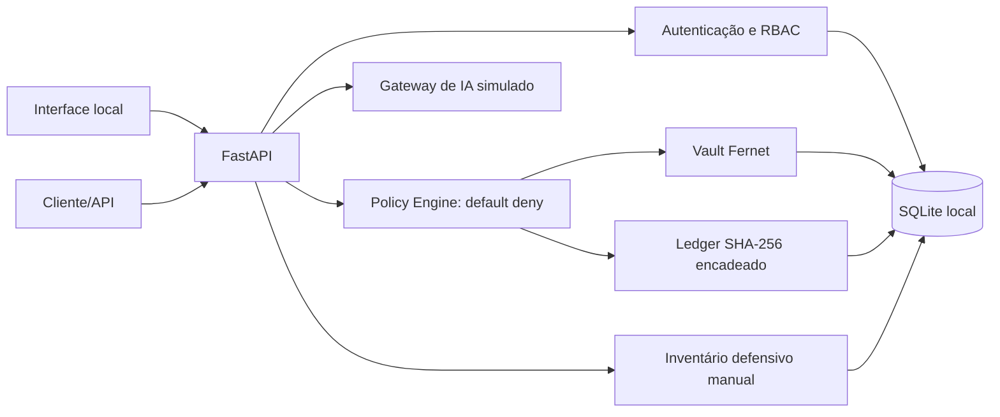

# Sentinela Brasil

**Plataforma aberta demonstrativa de soberania de dados, cibersegurança defensiva e IA confiável.**

- Organização informada: Impulso Digital Soluções em I.A.
- Fundador/responsável informado: Felipe Marcos de Abreu Aquino
- Repositório pretendido: `sentinela-brasil`
- Versão de software: `0.1.0` (núcleo demonstrativo; não é release de produção)
- Idiomas: português brasileiro e inglês
- Licença: Apache-2.0

> **Aviso:** iniciativa independente. Não representa aprovação, certificação, homologação, endosso ou adoção de qualquer órgão governamental, militar ou de infraestrutura crítica. Use exclusivamente dados sintéticos para demonstração. Não é solução pronta para produção nem mecanismo de proteção de sistemas críticos.

## Missão e escopo

Demonstrar, em execução local, como aplicar controles explícitos de acesso a dados, cifrar arquivos em repouso, registrar operações com verificação de integridade, avaliar regras explicáveis e impedir que uma demonstração de IA envie dados a serviços externos. A versão inicial é intencionalmente pequena e não realiza varredura de rede, exploração, execução de comandos, chamada a modelo externo ou coleta clandestina.

## Funcionalidades implementadas

- **Vault local:** upload JSON/Base64 de arquivos de até 2 MiB, lista de tipos permitidos, validação básica, cifra Fernet via `cryptography`, classificação, RBAC e exportação autorizada.
- **Identidade e acesso:** bootstrap explícito de administrador, hash de senha scrypt da biblioteca padrão, token bearer HMAC com validade de uma hora, criação administrativa de usuários e negação por padrão nas regras de acesso a arquivos.
- **Policy Engine:** regras declarativas versionadas por função, classificação e operação, com `reason_code` e versão da política na decisão.
- **Ledger de auditoria:** encadeamento SHA-256, eventos minimizados e endpoint de verificação. É detecção de alteração, não imutabilidade absoluta.
- **Trusted AI Gateway demonstrativo:** detecção heurística de padrões de e-mail, CPF-like e credenciais; modo estrito bloqueia padrões detectados e modo `redact` mascara; nenhuma API/modelo externo é chamado.
- **Perfil defensivo de ativos:** cadastro e leitura de inventário sintético sem conexão a redes ou dispositivos.
- **Painel web local:** autenticação, contagens, eventos recentes, estado da cadeia e inventário; HTML seguro por `textContent`, sessão mantida em `sessionStorage` e cabeçalhos básicos.
- **Qualidade:** pytest, workflow GitHub Actions, lint Ruff, auditoria de dependências e geração de artefato SBOM no CI.

## Arquitetura



Fluxo de dados e fronteiras: [docs/architecture/ARCHITECTURE.md](docs/architecture/ARCHITECTURE.md). Modelo de ameaças: [docs/threat-model/THREAT_MODEL.md](docs/threat-model/THREAT_MODEL.md).

## Pré-requisitos

Python 3.11 ou superior. Docker Compose é opcional. A versão inicial foi projetada para um processo local e um único banco SQLite; não rode múltiplos workers.

## Instalação e execução local (Linux/macOS)

```bash
git clone https://github.com/felipetjmg1-bit/sentinela-brasil.git
cd sentinela-brasil
python3 -m venv .venv
. .venv/bin/activate
python -m pip install --upgrade pip
pip install -e '.[test,dev]'
cp .env.example .env
```

Edite `.env` e substitua todos os placeholders. Gere segredos novos, não os reutilize:

```bash
python -c 'import secrets; print(secrets.token_urlsafe(48))'  # SENTINELA_TOKEN_SECRET
python -c 'from cryptography.fernet import Fernet; print(Fernet.generate_key().decode())'  # SENTINELA_VAULT_KEY
python -c 'import secrets; print(secrets.token_urlsafe(24))'  # senha única (mín. 16 caracteres)
```

No terminal Bash, carregue o `.env` e inicie em loopback:

```bash
set -a; . ./.env; set +a
uvicorn sentinela.main:app --app-dir src --host 127.0.0.1 --port 8000 --workers 1
```

Na primeira inicialização, o administrador é criado apenas se a base não contiver usuários e se `SENTINELA_BOOTSTRAP_ADMIN_USERNAME` e `SENTINELA_BOOTSTRAP_ADMIN_PASSWORD` estiverem definidos. Remova essas duas variáveis depois do bootstrap e guarde a senha em gerenciador apropriado. Abra `http://127.0.0.1:8000/`. A documentação OpenAPI estará em `/docs` enquanto o servidor for local.

No Windows, use Python 3.11+, crie `.venv` com `py -m venv .venv`, ative em PowerShell com `.venv\Scripts\Activate.ps1`, instale os extras e defina as variáveis no terminal/ambiente antes de executar Uvicorn. Evite expor a porta à rede.

### Instalação em celular

O painel é responsivo e pode ser aberto no navegador do celular se um computador executar o serviço. Para acesso na mesma rede, configure firewall e TLS em um proxy reverso e entenda que a v0.1.0 não foi endurecida para exposição em LAN. Android com Termux pode ser usado somente como experimento individual, não como implantação suportada; iOS não é um ambiente de execução suportado. O caminho recomendado é computador local e acesso via `127.0.0.1`.

## Docker Compose

Configure `.env` com chaves e senha fortes antes de iniciar. O serviço fica publicado apenas no loopback do host; os dados ficam no volume local `sentinela_data`.

```bash
docker compose up --build
```

Veja [docs/deployment/DEPLOYMENT.md](docs/deployment/DEPLOYMENT.md) para backup, restauração e exclusão segura. Um backup do banco sem as chaves externas não restaura o conteúdo cifrado.

## Exemplo reproduzível

Depois do primeiro início:

```bash
curl -s http://127.0.0.1:8000/api/auth/login \
  -H 'Content-Type: application/json' \
  -d '{"username":"admin","password":"SUA_SENHA_LOCAL"}'
```

Use o `access_token` retornado como `Authorization: Bearer <token>` em `/api/dashboard`, `/api/policies` e `/api/assets`. O gateway local pode ser testado em `POST /api/ai/evaluate` com `{"prompt":"Texto sintético de demonstração","mode":"strict"}`. Nenhuma inferência real ocorre. A documentação da API local está em `/docs`.

## Testes e desenvolvimento

```bash
pytest
ruff format --check .
ruff check .
pip-audit --skip-editable
```

Os testes cobrem autenticação, RBAC negativo, isolamento por objeto, cifra e exportação, upload inválido, bloqueio/redação no gateway, detecção de adulteração no ledger, ativos, painel e cabeçalhos. Resultados executados são relatados no registro de entrega; o workflow CI repete verificações em push e pull request. O SBOM CycloneDX é artefato do job CI, não prova de ausência de vulnerabilidades.

## Segurança, privacidade e modelo de ameaças

Leia [SECURITY.md](SECURITY.md), [docs/threat-model/THREAT_MODEL.md](docs/threat-model/THREAT_MODEL.md) e [docs/privacy/PRIVACY.md](docs/privacy/PRIVACY.md). Controles demonstrativos não substituem análise de risco, revisão independente, teste de intrusão autorizado, TLS, gestão centralizada de chaves, backup testado, resposta a incidentes ou controles organizacionais.

### Limitações conhecidas

SQLite local, um único processo e sem alta disponibilidade/multi-tenant; tokens bearer duram uma hora e não têm revogação individual; ausência de rate limiting robusto; chave Fernet/HMAC fica sob gestão do operador; não há KMS/HSM, rotação automatizada, mTLS, SSO, CSRF (o painel usa bearer API), trilha WORM ou âncora externa; inspeção de conteúdo não detecta todos os dados pessoais; redação por regex pode falhar; inventário não verifica configuração de sistemas remotamente; gateway de IA é simulado. Ledger permite reescrita completa por quem controla arquivo e host. Veja o roadmap e a seção de limitações nos documentos.

## Posicionamento e roadmap

O projeto é uma iniciativa aberta brasileira de pesquisa e desenvolvimento sobre soberania de dados, segurança defensiva e governança de IA. Aplicações potenciais em organizações públicas, pesquisa e infraestrutura crítica requerem avaliação, adequação jurídica, controles operacionais e validação independente antes de qualquer uso real. Não há alegação de adoção institucional.

Roadmap sugerido: (1) revisão independente de segurança e acessibilidade; (2) migrações testadas, revogação de sessão, rate limit e autorização por objeto ampliada; (3) KMS/HSM e rotação de chave; (4) âncoras externas/WORM e backup/restore exercitados; (5) avaliação de privacidade, desempenho e conformidade aplicável; (6) somente então avaliar integrações opcionais sob aprovação e controles de minimização.

## Contribuições e contato

Veja [CONTRIBUTING.md](CONTRIBUTING.md) e [CODE_OF_CONDUCT.md](CODE_OF_CONDUCT.md). Reportes de segurança: [SECURITY.md](SECURITY.md). Contato institucional deve ser configurado pelo mantenedor no perfil do GitHub; não há canal de suporte assumido por este demonstrador.

## Relevância estratégica

Leia [STRATEGIC_RELEVANCE_BR.md](STRATEGIC_RELEVANCE_BR.md), que separa potencial, evidências existentes, validações pendentes, riscos e plano de avaliação independente.


## Revisão demonstrativa de ativo

Após cadastrar um ativo sintético, use `GET /api/assets/{id}/review`. A resposta oferece recomendações defensivas genéricas com base apenas na criticidade e nos metadados; não executa varredura, valida configuração técnica real nem certifica o ativo.
