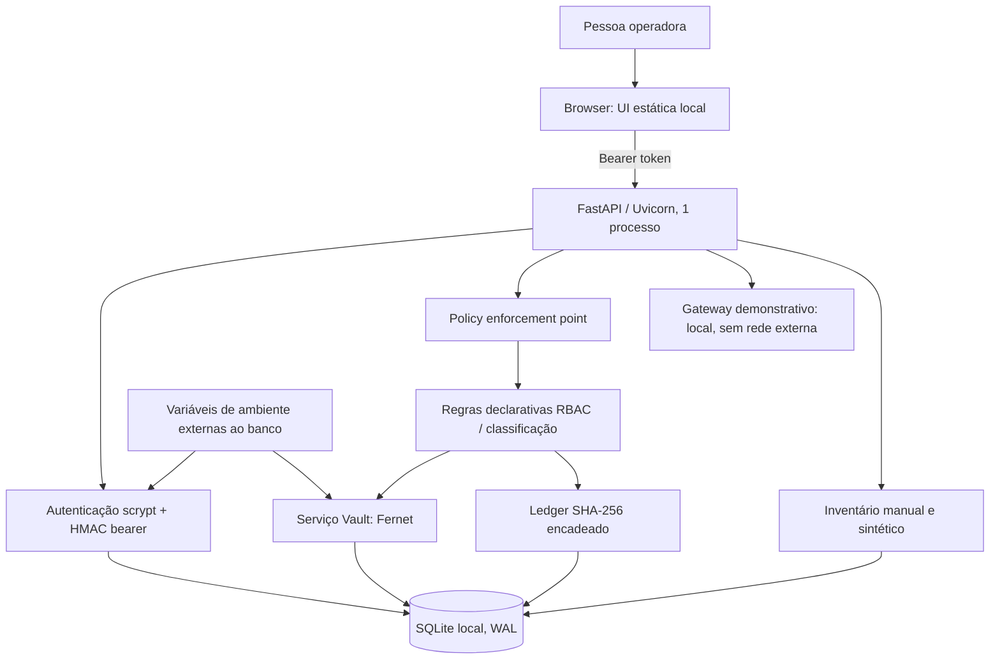
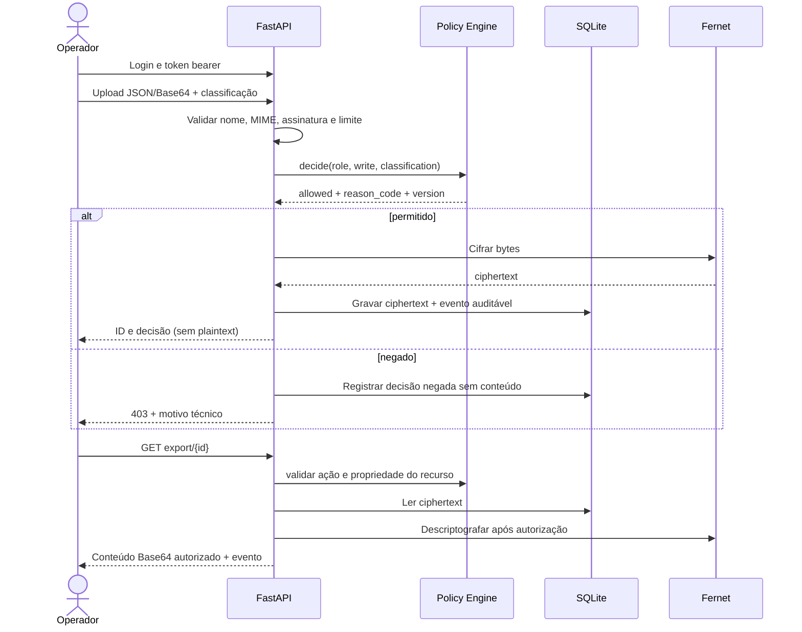

# Arquitetura e fluxo de dados

## Componentes v0.1

## Fluxo de upload e exportação

## Limites de confiança

- Browser e cliente são não confiáveis; o token bearer dá acesso equivalente à conta durante até uma hora.
- O processo, host, SQLite e variáveis de ambiente são confiados operacionalmente. Comprometimento do host permite leitura de memória/segredos e reescrita da base.
- O arquivo do banco contém ciphertext Fernet para conteúdo, mas nomes, classificação, tipos, IDs e timestamps são metadados legíveis.
- O gateway não chama rede e devolve somente resposta fixa; seus filtros por padrões são demonstração, não DLP completa.
- O inventário recebe dados fornecidos diretamente; não executa descoberta nem valida configuração remota.

## Persistência e concorrência

SQLite ativa `foreign_keys`, `busy_timeout` e WAL. O projeto deve executar com um worker. SQLite permite concorrência limitada e não é adequado para múltiplos nós/alta disponibilidade. Ledger e alteração de estado são gravados na mesma transação para operações principais. Para uma carga maior, migre após desenho e revisão, não apenas trocando a URL.

## Criptografia

- Senhas: `hashlib.scrypt` da biblioteca padrão com salt aleatório por usuário e parâmetros codificados no hash.
- Tokens: payload local assinado com HMAC-SHA256 e expiração de uma hora; formato privado do projeto, não JWT interoperável.
- Arquivos: Fernet da biblioteca `cryptography`, chave base64 URL-safe injetada por ambiente. Fernet cifra e autentica bytes, mas não substitui KMS/HSM nem protege contra comprometimento do processo.
- Ledger: SHA-256 do JSON canonicalizado. Uma cadeia recalculada ou removida integralmente pelo controlador do banco não é detectada sem âncora externa.
